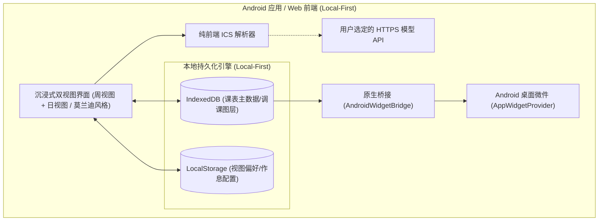

# 📅 Course Schedule (本地优先课程表)

[](https://opensource.org/licenses/MIT)
[](https://developer.android.com)
[]()

> 一款本地优先的个人课程表应用。课表保存在设备上；用户主动使用教务同步或配置 AI 调课时，会连接对应的学校或模型服务。

---

## ✨ 核心特性

- 📱 **轻量 Android 本地客户端 (< 5 MB)**
  - 基于 Capacitor 深度精简与优化，无体积冗余，冷启动秒开，极致丝滑。
  - **原生 Android 桌面小组件 (AppWidget)**：支持长按桌面添加微件，主屏幕即时展示当日课程、上课教室与时间，无需打开 App 即可快速查课。
- 🎨 **双模沉浸式课程视图**
  - **周视图 (Week View)**：12 款高级莫兰迪护眼色卡（确定性哈希算法）、1~20 周自由滑动切换、自动校准当前周次、今日专属高亮条、连节大课智能网格排布。
  - **日视图 (Day View)**：时间流纵向呈现，精准区分“正在进行”、“下节即将开始”与“已结束”，独创午休与晚餐长课段智能倒计时。
- 🤖 **大模型驱动 AI 自然语言智能调课**
  - **增加课程、调课、停课**：模型返回规定的 JSON 动作，本地校验后写入独立调整图层。指定日期按某星期补课时，模型只返回日期指向，课程由本地读取；普通单课调整会把课程名称、教师、教室和时间发给用户选定的 HTTPS 模型端点，不经过本项目服务器。
  - **明确日期上下文**：AI 请求包含设备本地今天的日期、星期和实际学期周次，并单独标明当前浏览周；“今天”“本周”等相对日期以设备今天为基准。
  - **冲突提示**：同一天有效课程节次重叠时，周视图和日视图均将相关课程标红并显示“冲突”；点击课程可查看重叠课程。停课卡片不参与冲突计算。
  - **假期后的补课**：补某一天的课程时，来源取该日原始排课；即使来源日已被放假记录标记停课，也能在补课日恢复这些课程。此前保存的补课记录会自动按新规则显示。
  - **个人 Key 存储**：Android 6 及以上使用 AndroidKeyStore 加密保存 Key；浏览器预览和 Android 5 仅在当前运行期间保留。设置界面以密码输入框遮挡 Key。
  - **支持模型列表一键拉取**：设置页支持自动拉取端点支持的模型列表，一键导入模型名称。
  - **独立调整图层与一键撤销**：调课记录独立标记保存，原课表底座完好无损，随时可一键撤销还原。
- 📥 **本地 ICS 日历极速导入与备份导出**
  - **导入**：支持 WakeUp 课程表 (醒狮课表) 及通用高校教务系统导出的 `.ics` / `.txt` 日历文件，纯前端 FileReader 毫秒级解析 13 门实体课程与 18 个排课时段。
  - **教务同步**：南京晓庄学院当前入口仅能通过 HTTP 访问。此方式缺少 HTTPS 传输保护，网络中的第三方可能查看或篡改登录页面、会话与课表流量；应用在登录页明确提示，并提供本地 ICS 文件导入供选择。
  - **导出**：一键将本地课表打包导出为标准 RFC 5545 `.ics` 日历文件，方便备份、跨设备迁移或导入系统日历。
- 🛡️ **本地持久化 (Local-First)**
  - 采用 **IndexedDB + LocalStorage** 保存课表与偏好；Android 6 及以上的模型 API Key 使用系统密钥库加密保存。课表数据默认保存在用户手机本地。
  - **无项目方服务器收集**：默认不上传课表。教务同步会连接学校服务；AI 调课会连接用户选定的第三方模型端点。
- ☕ **开发者支持与赞助**
  - 设置页面内置开发者微信赞赏码（点击弹窗放大预览），用户可自愿赞助支持持续维护。

---

## 🏗️ 架构设计



---

## 📂 目录结构

```text
course_schedule_open/
├── client/                     # 纯前端与 Android 原生工程
│   ├── index.html              # 纯静态入口
│   ├── capacitor.config.json   # Capacitor 配置
│   ├── src/
│   │   ├── main.js             # 主程序引导
│   │   ├── api/                # 接口桩与客户端定义
│   │   ├── assets/             # 静态资产 (微信赞赏码等)
│   │   ├── data/               # 默认课表与节次配置
│   │   ├── storage/            # IndexedDB / LocalStorage 本地存储引擎
│   │   ├── utils/              # icsParser、morandi色彩、localAiAdjuster
│   │   └── views/              # 周视图、日视图、设置弹窗、导入弹窗、调课弹窗
│   └── android/                # Capacitor Android 原生壳 (含桌面小组件实现)
├── dist/                       # Release APK 输出目录
├── scripts/
│   ├── build_apk.ps1           # Android Release APK 一键自动化编译脚本
│   └── check_syntax.js         # 前端语法全量校验工具
├── tests/                      # 离线核心算法与 ICS 解析测试套件
│   └── ics_parser.test.js      # ICS 高容错解析与 7 大陷阱防御测试
└── README.md                   # 项目说明文档
```

---

## 📱 Android 原生编译与打包

本项目自带轻量化 Capacitor Android 工程（已配置好 ProGuard 混淆与原生桌面微件）。

### 环境要求
- JDK 17+
- Android SDK (API 34)

### 签名并打包 Release APK

先在仓库外保管正式签名密钥，再为当前 PowerShell 会话设置以下环境变量：

```powershell
$env:COURSE_SIGNING_STORE_FILE = 'C:\path\outside-repo\release.p12'
$env:COURSE_SIGNING_STORE_PASSWORD = '<密钥库密码>'
$env:COURSE_SIGNING_KEY_ALIAS = 'course-schedule'
$env:COURSE_SIGNING_KEY_PASSWORD = '<密钥密码>'
```

构建脚本优先使用 `JAVA_HOME` 与 `ANDROID_HOME` / `ANDROID_SDK_ROOT`；未设置时查找本机 JDK 与 Android SDK。签名密钥及密码不得提交到仓库。
在 Windows PowerShell 终端中执行：

```powershell
powershell -ExecutionPolicy Bypass -File scripts\build_apk.ps1
```

构建脚本将自动完成：
1. 前端最新静态资源全量同步到 Android `assets/public/`；
2. 进程内存级环境变量加载（绝对不污染全局系统环境）；
3. 调用 Gradle 执行 Release 编译；
4. 严格校验 APK 体积（**保证 < 5.0 MB**，实测约 2.8 MB）；
5. 产物输出至：`dist/course_schedule_standalone.apk`。

---

## 🧪 自动化测试验证

在根目录下可一键运行核心引擎测试套件：

```bash
# 1. 前端全模块语法树校验
node scripts/check_syntax.js

# 2. 前端双视图与本地持久化测试
node client/test_client.js

# 3. ICS 课表智能解析引擎与 7 大陷阱防御测试
node tests/ics_parser.test.js

# 4. 安全回归测试
node tests/security.test.js

# 5. 调课与凭据存储回归测试
node tests/adjustments.test.js
```

---

## ☕ 赞助与支持

如果您觉得这个极简课表 App 对您的校园生活有所帮助，欢迎扫描设置页面中的微信赞赏码，请开发者喝一杯咖啡！您的鼓励是项目持续优化的最大动力。

---

## 📄 开源许可证 (License)

本项目自有代码按 [MIT License](LICENSE) 开源；内置的 Capacitor Android 与其中引用的第三方源码保留各自许可，见 [第三方许可说明](THIRD_PARTY_NOTICES.md)。欢迎学习、使用和二次开发。

公开仓库时，请以本项目目录建立独立仓库，或仅提交本目录文件。不要从包含其他项目的上级目录直接创建公开仓库。签名密钥、`local.properties`、真实课表和本机数据不得提交；`dist/*.apk` 默认忽略，正式 APK 可作为单独发布资产。项目自带的赞赏码图片会随源码公开。
